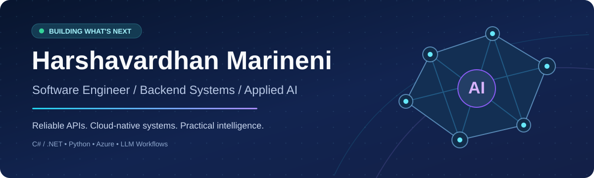
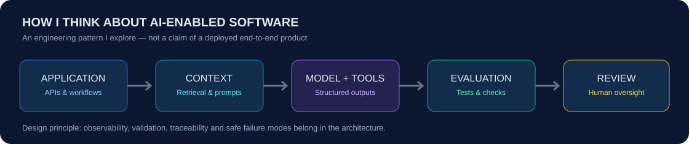

 

**Backend Engineering** &nbsp;·&nbsp; **Cloud Platforms** &nbsp;·&nbsp; **AI-Enabled Applications** &nbsp;·&nbsp; **Performance & Reliability**

## About me

I’m **Harshavardhan**, a software engineer with **6+ years of experience** across healthcare, financial services, academic research, and automotive systems. I enjoy making complex systems simpler: turning requirements into resilient APIs, tracing hard-to-find bottlenecks, and improving the software people depend on.

My core background is in **backend development, distributed systems, cloud engineering, and performance analysis**. Increasingly, I’m exploring how **LLMs, retrieval, tool-based automation, and structured evaluations** can augment those systems responsibly.

> **What drives my work:** Build useful software. Make it observable. Measure the outcome. Keep the human in control when AI is involved.

## Technology landscape

| Backend & languages | Cloud & engineering | AI & intelligent workflows |
| :---: | :---: | :---: |
|   |   | `LLM application patterns` `Prompt design` |
|   |   | `Context engineering` `Tool orchestration` |
|   | `CI/CD` `Linux` `Observability` | `RAG concepts` `Evaluations` `Human review` |

## Applied AI meets software engineering

I’m interested in **production-minded AI design**, not just impressive demos. That includes designing deterministic interfaces around probabilistic outputs, validating structured responses, testing failure cases, and treating security and traceability as first-class concerns.

**Areas I work with or explore:** Prompt and context engineering · LLM API integration patterns · Tool-using workflows · Retrieval-augmented generation (RAG) concepts · Evaluation sets · Python automation · Human-in-the-loop validation.

These AI areas include engineering practices from my background and subjects I am actively exploring; they do not imply that every pattern has been deployed by me in production.

## Experience snapshot

| Journey | Engineering focus |
| :--- | :--- |
| **TeamCare** · May 2024–Present | Healthcare workflows, backend reliability, service performance and operational engineering |
| **JPMorgan Chase** · May 2023–May 2024 | Backend platforms, scalable service patterns, CI/CD and observability |
| **Texas Tech University** · Aug 2022–May 2023 | CPU/GPU experiments, C++ and Python benchmarking, performance research |
| **Bosch** · Dec 2019–Jul 2022 | Systems software, cross-layer debugging and engineering fundamentals |

## Featured engineering directions

<table>
<tr>
<td width="50%" valign="top"><h3>01 · AI Knowledge Assistant</h3><b>Concept / portfolio idea</b>
Retrieval-based answers, cited sources, API boundaries, and repeatable evaluation checks.
<code>Python</code> <code>.NET</code> <code>RAG</code></td>
<td width="50%" valign="top"><h3>02 · AI Document Workflow</h3><b>Concept / portfolio idea</b>
Structured extraction, output validation, traceable decisions, and human review.
<code>LLM APIs</code> <code>Validation</code> <code>Azure</code></td>
</tr>
<tr>
<td width="50%" valign="top"><h3>03 · Cloud-Native API</h3><b>Concept / portfolio idea</b>
Well-tested backend services, deployment automation, monitoring, and failure handling.
<code>C#</code> <code>ASP.NET Core</code> <code>CI/CD</code></td>
<td width="50%" valign="top"><h3>04 · Performance Benchmarking</h3><b>Concept / portfolio idea</b>
Reproducible experiments, profiling, regression detection, and evidence-based optimization.
<code>Python</code> <code>C++</code> <code>Linux</code></td>
</tr>
</table>

> **Repository spotlight:** These are showcase concepts, not links to completed projects. As I publish the corresponding code, I’ll replace the concepts with live repositories, architecture diagrams, and short demos.

## Certifications & education

**Master of Science, Computer Science and Engineering** — Texas Tech University

  
  

## Let's connect

**Building reliable systems today — exploring intelligent systems for tomorrow.**

[Portfolio](https://harshavardhanmarineni-portfolio.netlify.app/) &nbsp;·&nbsp; [LinkedIn](https://www.linkedin.com/in/harshavardhanchoudary/)

